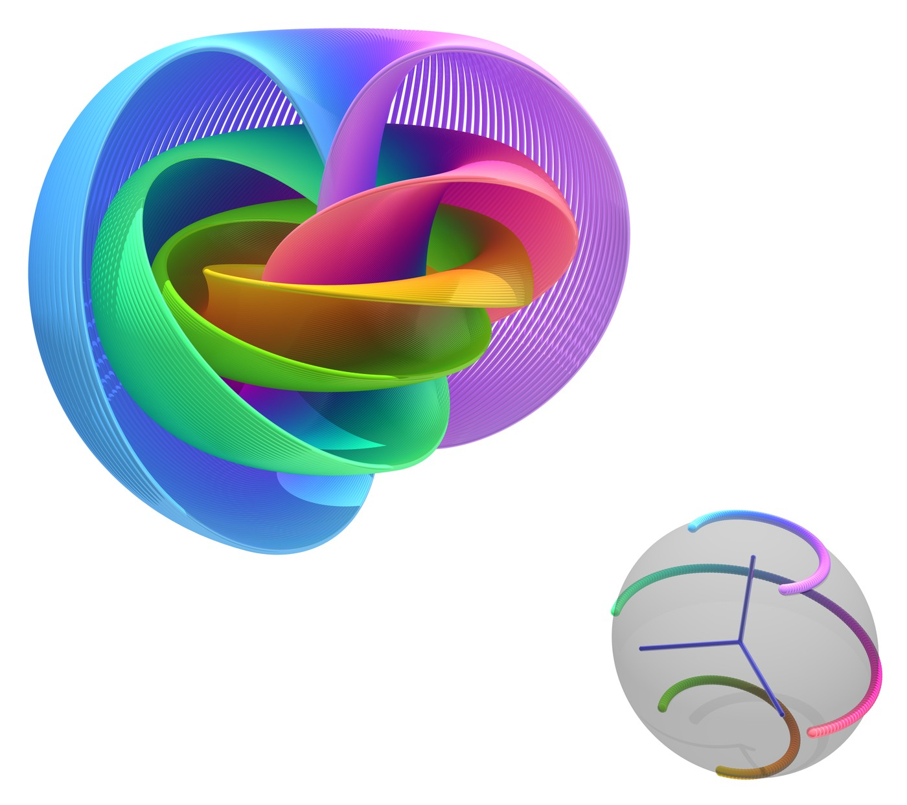

<figure class="align-right" style="width: 380px">
  
  <figcaption>Visualization of the Hopf fibration. Image: <a href="https://commons.wikimedia.org/wiki/File:Hopf_Fibration.png">Niles Johnson</a>, <a href="https://creativecommons.org/licenses/by/4.0/">CC BY 4.0</a>, via Wikimedia Commons (resized).</figcaption>
</figure>

Welcome to my academic homepage.

I am a 7th year graduate student at the University of Arkansas. I will have earned my PhD in May 2027 working under Dr. Jeremy Van Horn-Morris. My upcoming thesis "Algorithmic Legendrian Realization of Open Book Decompositions of Contact 3-manifolds" explores the Giroux Correspondence between open book decompositions of 3 manifolds, and Contact Structures, in the lens of legendrian realization of monodromy substitution. In particular, cork operations on the 4 manifold level can descend to monodromy substitutions on Lefschetz Fibrations, and thus on the open book decompositions of the boundary 3 manifold.

## Research Interests
- Contact and symplectic topology
- Legendrian knot invariants
- 3‑manifold geometry
- Computational visualization

