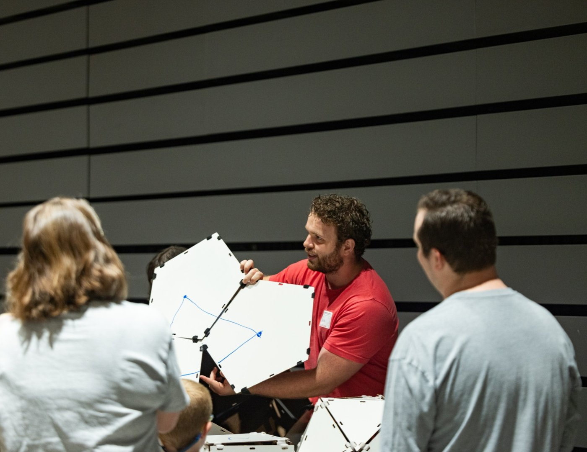

I enjoy sharing mathematics with audiences beyond the research community, especially the geometry and topology that can be built, drawn, or held in your hands.

## Arkansas Math Discovery Day

[Arkansas Math Discovery Day](https://amdd.uark.edu/) is a family-oriented community event, hosted by the University of Arkansas Department of Mathematical Sciences and the Fayetteville Public Library, that presents math beyond the classroom through patterns, puzzles, and open questions. It is geared toward youth ages 6 to 16, with booths and math games set up in the local library so that visitors learn hands-on.

<figure style="max-width: 520px; margin: 1.75em auto; text-align: center;">
  
  <figcaption>Hands-on Platonic solids at Arkansas Math Discovery Day.</figcaption>
</figure>

I lead the Platonic Solids and Gaussian Curvature booth. Using large models of the Platonic solids, we introduce visitors to the Euler characteristic and to polygon angles in non-Euclidean geometry. Visitors also draw on a flat map the path they think is the quickest between two distant cities. We then copy that path onto a globe and use a string with magnets to show the true shortest path, which looks curved on the flat map. Combining visualization with tactile learning has worked especially well with budding young mathematicians.

- **Volunteer and booth lead, "Platonic Solids and Gaussian Curvature"** — *Arkansas Math Discovery Day*, Spring 2026 and Spring 2025. [Website](https://amdd.uark.edu/)

## University of Arkansas High School Math Day

Each year, the Department of Mathematical Sciences hosts students from several local high schools to show off the department and the University, a tradition continued from Dr. Mantero. I am volunteering at this year's University of Arkansas High School Math Day, where volunteers lead hands-on activities in the style of Arkansas Math Discovery Day and other math-heavy games, and then join the students over a pizza lunch to chat and answer their questions.

- **Volunteer, University of Arkansas High School Math Day** — *University of Arkansas Department of Mathematical Sciences*, Thursday, November 12, 2026.
