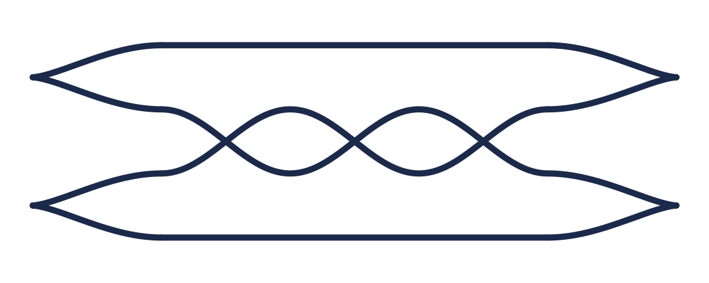

## Overview
My research is in low-dimensional topology, specifically contact 3-manifolds and the symplectic 4-manifolds they bound. Dimensions 3 and 4 are the lowest dimensions where unusual phenomena occur; dimension 4, for example, is the only dimension in which ℝ⁴ has uncountably many different smooth structures. The tools for studying these manifolds draw on algebraic geometry, complex analysis, homological algebra, dynamics, and combinatorics.

[Read my research statement (PDF)](/assets/statements/Kevin_Tuttle_Research_Statement.pdf)

## Dissertation
**Algorithmic Legendrian Realization of Open Book Decompositions of Contact 3-manifolds**, under Dr. Jeremy Van Horn-Morris. Defense expected May 2027.

My work centers on the algorithmic use of the Giroux Correspondence: an equivalence between contact structures on a 3-manifold, usually described by knot surgery diagrams, and open book decompositions, which describe the manifold through mapping class groups. Bourgeois, Ekholm, and Eliashberg's differential graded algebra (DGA) invariants are computed from Legendrian surgery diagrams, so a long-standing question is whether such invariants can be computed directly from an open book decomposition. Avdek and Stenhede, among others, have worked out how to convert open books into surgery diagrams, and my work concerns the algorithmic side of that conversion.

<figure class="align-right" style="width: 380px">
  
  <figcaption>The standard Legendrian trefoil in front projection (plat position), with two left cusps, two right cusps, and three crossings.</figcaption>
</figure>

Specifically, I am interested in the process of entering an open book decomposition into a program, getting back a surgery diagram in Gompf normal form, and then computing invariants of the contact structure from it, such as Legendrian contact homology or the d₃ invariant. Part of this work is Python code, which you can find on [GitHub](https://github.com/KJTuttle/legendrian_links).

One motivation comes from corks: a cork twist on a 4-manifold can descend to a monodromy substitution on a Lefschetz fibration, and so to a monodromy substitution on the open book decomposition of the boundary 3-manifold. Realizing those substitutions with Legendrian knots is what makes them visible in a surgery diagram.

## Recent talk
I presented this work at the AMS Fall Eastern Sectional Meeting (October 3, 2026). The talk is based on R. Avdek's *Contact surgery and supporting open books* (Algebr. Geom. Topol. 13, 2013) and E. Stenhede's [*An algorithm to Legendrian realize a curve on a ribbon surface*](https://arxiv.org/abs/2604.08010) (2026), and covers:

- open books and the Giroux Correspondence;
- contact cell decompositions and ribbons;
- Avdek's algorithms, which pass between surgery diagrams and open books, with worked examples;
- Stenhede's improvement, which gives an explicit Legendrian realization of arbitrary homologically nontrivial curves on a ribbon, beyond the Lickorish curves in Avdek's setting;
- the computational side, including plat presentations of Legendrian links and Legendrian contact homology.

[Slides (PDF)](/assets/talks/AMS_DC_2026_Kevin_Tuttle_Presentation.pdf)

## Research interests
- Contact and symplectic topology
- Legendrian knot invariants
- 3‑manifold geometry
- Computational visualization

## Mentoring undergraduate research
I hope to mentor undergraduates in research projects, and knot theory is a very accessible way in. Without the full topological machinery, there are several homology theories for calculating knot invariants, for example:

1. Legendrian contact homology
2. Knot Floer homology (via grid diagrams)
3. Khovanov homology

Calculating such invariants would give students experience with knot theory, with algebraic ideas like the homology of a chain complex or DGA, and with algorithmic thinking. Coding is optional depending on the project, but it can be a valuable skill to take into a career. Students could compute invariants for specific families of knots and contribute to the community's knot atlases as part of a thesis.

## Computation and visualization
See my [Projects](/projects/) page for code and notebooks, including Legendrian contact homology computations and visualizations of harmonic polynomials on the complex plane.
